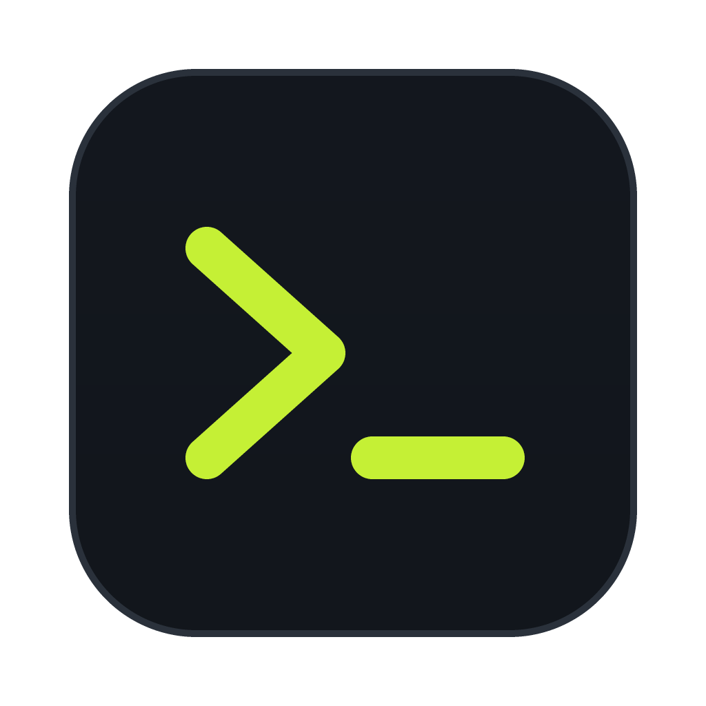

<p align="center"></p>

<h1 align="center">Shellyard</h1>

<p align="center">A native SSH, SFTP, tunnel and terminal manager with an encrypted vault.<br>
No webview, no account, no server, no telemetry.</p>

> [!WARNING]
> **Shellyard is in beta.** It works for daily use, but expect rough edges and
> keep a backup of your vault file. Please [report problems](https://github.com/SacerdosH3x/shellyard/issues).

Shellyard keeps your hosts, SSH keys, tunnels and notes in one file encrypted
with your master password (Argon2id + AES-256-GCM), and opens them in fast
native terminal tabs. It is written in Rust with [egui](https://github.com/emilk/egui)
and uses your system OpenSSH, so `known_hosts`, agents and `~/.ssh/config` keep working.

## Install

**macOS or Linux, one line:**

```sh
curl -fsSL https://raw.githubusercontent.com/SacerdosH3x/shellyard/main/install.sh | bash
```

The script downloads the latest release, checks its SHA-256, and installs
without `sudo`. On macOS it puts `Shellyard.app` in `/Applications` (or
`~/Applications`); on Linux it installs `~/.local/bin/shellyard` and a desktop
entry. You can [read it first](install.sh). Uninstall with
`curl -fsSL …/install.sh | bash -s -- --uninstall`.

**Homebrew:**

```sh
brew install sacerdosh3x/tap/shellyard
```

**From source** (Rust stable):

```sh
git clone https://github.com/SacerdosH3x/shellyard && cd shellyard
cargo run --release
```

On Debian/Ubuntu run `scripts/linux-deps.sh` first.

> **macOS note:** releases are not yet signed with an Apple Developer ID. The
> installer and Homebrew do not trigger Gatekeeper, but if you download the
> archive in a browser, macOS will refuse to open it. Right-click the app and
> pick **Open**, or run `xattr -dr com.apple.quarantine Shellyard.app`.

## Features

- **Hosts:** folders, favorites, tags, search, command palette (⌘⇧P), recent connections.
- **Terminals:** SSH, SFTP and local shells in tabs, with truecolor, scrollback and bracketed paste.
- **SSH keys:** use your `~/.ssh` keys or store keys inside the vault, generate ed25519 keys, install them with `ssh-copy-id`.
- **Tunnels:** local (`-L`), remote (`-R`) and SOCKS (`-D`) forwards with start/stop, status, a console for prompts, and auto-start.
- **Notes:** encrypted notes and command snippets, linked to hosts, pasted into a terminal with one click.
- **Security:** auto-lock when idle, secrets wiped from memory, OSC 52 clipboard writes blocked by default.

Planned: split panes and broadcast input, a graphical SFTP browser, a built-in SSH
client for saved passwords, Docker, RDP, encrypted backup and sync. See
[docs/PLAN.md](docs/PLAN.md).

## Security

The vault is a single file (`~/Library/Application Support/Shellyard/shellyard.vault`
on macOS, `~/.local/share/Shellyard/` on Linux; override with `SHELLYARD_VAULT`).
The master password is never stored and cannot be recovered.

Read [docs/SECURITY.md](docs/SECURITY.md) for the design, threat model, test
results and known limits. To report a vulnerability, please use
[GitHub private vulnerability reporting](https://github.com/SacerdosH3x/shellyard/security/advisories/new)
rather than a public issue.

## Development

```sh
cargo test                        # unit, fuzz-style and process tests
cargo clippy --all-targets
cargo audit                       # needs: cargo install cargo-audit
SHELLYARD_VAULT=/tmp/t.vault cargo run   # use a throwaway vault
scripts/package.sh macos|linux    # build a release archive into dist/
```

Releases: bump `version` in `Cargo.toml`, then push a tag `vX.Y.Z`. GitHub
Actions tests, builds macOS (universal) and Linux (x86_64, aarch64) archives and
publishes the release. Then run `scripts/update-tap.sh vX.Y.Z` to update Homebrew.

Contributions are welcome. Please open an issue before large changes.

## License

Licensed under either of [Apache License 2.0](LICENSE-APACHE) or
[MIT license](LICENSE-MIT) at your option. Unless you explicitly state
otherwise, any contribution you submit is dual licensed the same way.
